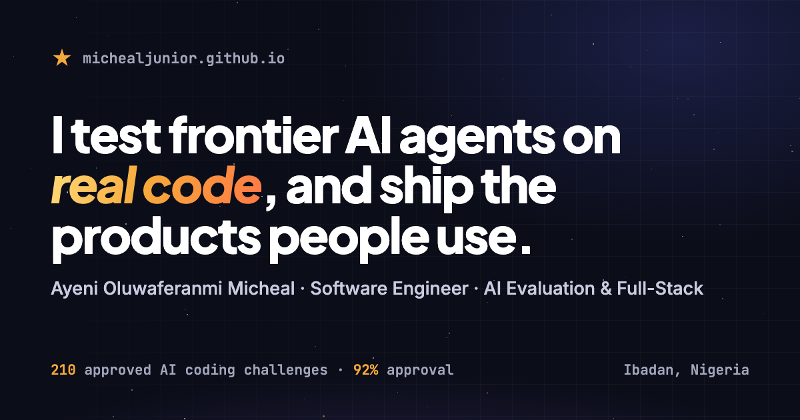

# starjnrdev.github.io

The portfolio of **Ayeni Oluwaferanmi Micheal**, a software engineer in AI evaluation and full-stack development based in Ibadan, Nigeria.

**Live:** https://starjnrdev.github.io



## What's inside

- A single, fast page: hero with a live terminal, about, selected work, experience, stack and contact.
- Hand-built with HTML, CSS, JavaScript and Three.js. No framework, no build step, no tracking.
- **SIGNAL** design: a cyber HUD theme with a Three.js data globe (live arcs from Ibadan, bloom glow), a scroll-driven 3D flight tunnel, glitch and decrypt text effects, a draggable 3D skill sphere, code rain, a boot sequence and a command palette (press <kbd>⌘K</kbd>, <kbd>Ctrl K</kbd> or <kbd>/</kbd>).
- Accessible by default: semantic landmarks, a skip link, keyboard-friendly navigation and palette, visible focus, and full `prefers-reduced-motion` support (no boot sequence, static 3D frames, no glitch loops).
- SEO ready: Open Graph and Twitter cards, JSON-LD `Person` data, sitemap and robots file.

## Projects featured

| Project | What it does |
| --- | --- |
| [tracelens](https://tracelens-app.vercel.app/) | See what your AI coding agents actually did: session logs and run bundles, compared side by side |
| [promptcheck](https://github.com/StarJnrDev/promptcheck) | Regression tests for LLM prompts, ready for CI |
| [repo-hub](https://repo-hub-app.vercel.app/) | Scout open-source repos and design fair, hard benchmark tasks for AI coding agents |
| [repo-doctor](https://repo-doctor-app.vercel.app/) | Audit a GitHub profile the way a recruiter sees it |
| [nuban-check](https://nuban-check.vercel.app/) | Validate Nigerian bank account numbers offline and repair broken spreadsheets |
| [naira-invoice](https://naira-invoice-app.vercel.app/) | Professional invoices for Nigerian freelancers, offline |

## Run locally

```sh
python3 -m http.server 8080
# open http://localhost:8080
```

## Licence

Code: MIT © 2026 Ayeni Oluwaferanmi Micheal. Written content and the résumé are © Ayeni Oluwaferanmi Micheal, all rights reserved.
